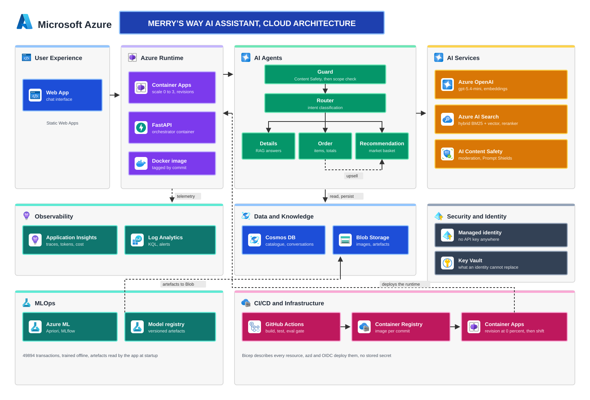
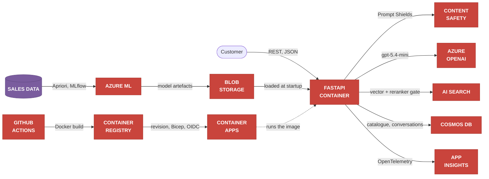
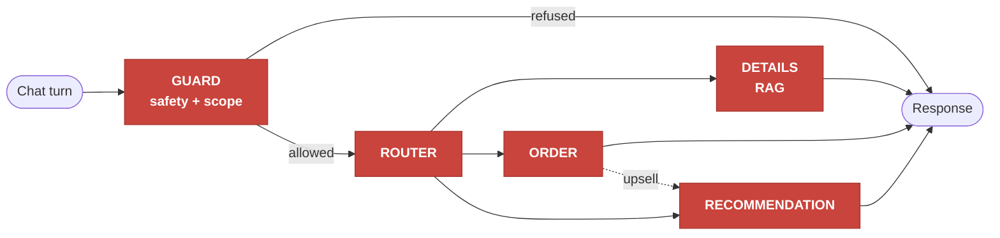
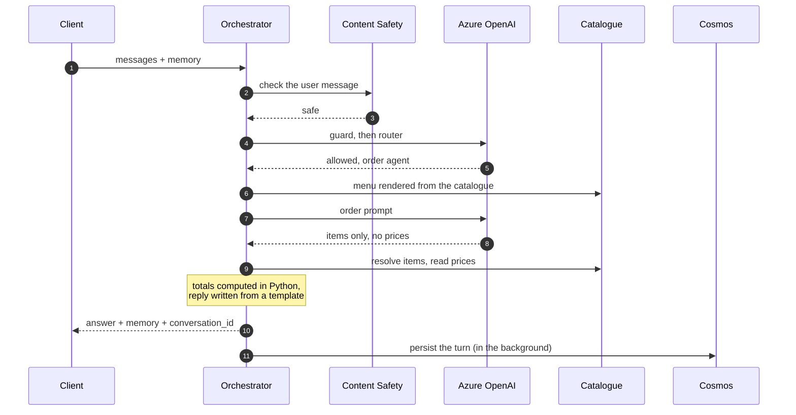
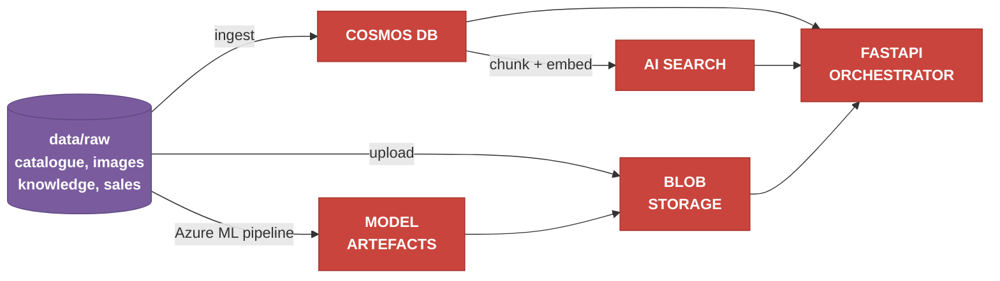
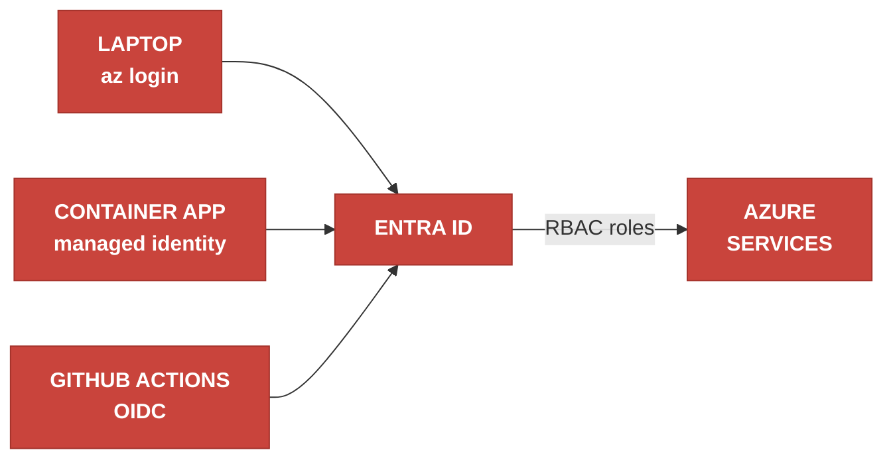
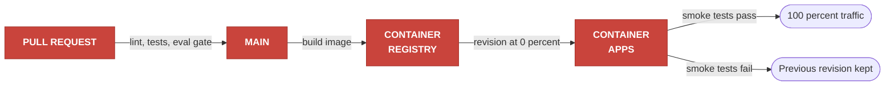

# Architecture

Diagrams stay at service level. Why each choice was made is recorded in an architecture decision record (ADR), named under each section.

Region: **France Central**. Environments: `dev`, `stg`. Naming and tagging: ADR-006.

---

## 1. Target architecture



Service icons are Microsoft's official Azure architecture icons, used unmodified.

<details>
<summary>The same view in Mermaid</summary>



</details>

---

## 2. Agent chain

One turn goes through at most one specialised agent.



- Guard is two layers, Content Safety then an LLM scope check, inside a hand-written orchestrator: ADR-001.
- Details retrieves before answering, and stays silent when nothing is relevant: ADR-008 (vector ranking gated by the semantic reranker; it superseded the hybrid retrieval of ADR-002 after measurement).
- Order extracts items, Python owns the prices: ADR-003.
- Recommendation reads model artefacts and answers only with catalogue items: ADR-004 and ADR-009.
- Every turn is persisted, none is held in session: ADR-005.

---

## 3. An order, in sequence

The most critical path, because business objective OM4 tolerates zero billing error.



Steps 8 to 10 are the point: the model returns identifiers and quantities only, and the reply is a template, so no number on a bill ever passes through the model, not even to be copied (ADR-003).

---

## 4. Data flow

What produces the data the runtime reads. None of this runs during a chat turn.



Cosmos DB is the source of truth, and the search index is derived from it: ADR-004.

---

## 5. Identity

No API key anywhere. The same code path authenticates in all three places.



| Principal | Authenticates with | Roles |
|---|---|---|
| - | `az login`, read by `DefaultAzureCredential` | same as the app, for local runs |
| The API | user-assigned managed identity | Cognitive Services OpenAI User and User (Content Safety), Search Index Data Reader, Cosmos DB data contributor (data plane role), Storage Blob Data Reader, Key Vault Secrets User, AcrPull, Monitoring Metrics Publisher |
| CI/CD | OIDC federated credential, no stored secret | Contributor on the resource group |

---

## 6. Delivery



Blue and green comes from Container Apps revisions, so no extra infrastructure is needed (OT5, ADR-011).
The evaluation gate blocks a change that degrades quality (ADR-010).

---

## 7. Traceability

One `conversation_id` links every span, metric and stored turn, which is what makes a failed conversation replayable (US6).

```
POST /chat                   conversation_id
└── chat.turn                agent, route, guard verdict, tokens
    ├── guard
    │   ├── content_safety   moderation and Prompt Shields verdict
    │   └── chat <model>     scope decision
    ├── router
    │   └── chat <model>     chosen agent
    └── agent <route>
        ├── search.query     retrieved documents (details)
        └── chat <model>     answer or order extraction
```

Model spans follow the OpenTelemetry GenAI convention (`gen_ai.*`).
Custom metrics: `chat.turns`, `chat.tokens`, `chat.cost.usd`, `chat.turn.duration`, `guard.blocked`, `order.total.mismatch`.
The last one alerts at severity 1 above zero: it means a customer was quoted the wrong amount.
